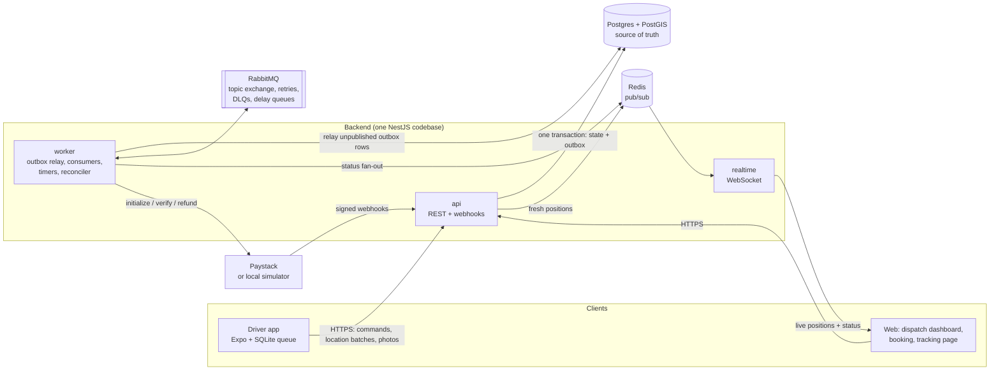

# Waybill

A same-day delivery platform for Nigerian cities: customers book and pay, a dispatcher watches every order and driver on a live map, and drivers run each job from a mobile app that keeps working without signal.

The point of the project is the backend's correctness under failure. You can kill the api, the worker or RabbitMQ in the middle of deliveries, lose or duplicate payment webhooks, or take a driver offline mid-trip, and a checker confirms afterwards that **no order was lost, nobody was charged twice, and the books balance**. All of that runs from one command.

| Part | Stack |
| --- | --- |
| Backend | NestJS · Postgres + PostGIS · RabbitMQ · Redis · `pg` with plain SQL |
| Web | Next.js (dispatcher dashboard, customer booking, shareable tracking page) · MapLibre |
| Driver app | Expo (React Native) · SQLite command queue · expo-location / camera |
| Payments | Paystack test mode, plus a local Paystack simulator for repeatable demos |

Design docs: [spec](docs/SPEC.md) and six ADRs ([monolith on Vercel](docs/adr/0001-modular-monolith-on-vercel.md), [state machine & assignment](docs/adr/0002-state-machine-and-assignment.md), [real-time location](docs/adr/0003-realtime-location.md), [payments](docs/adr/0004-payments.md), [events & queues](docs/adr/0005-events-and-queues.md), [offline-first driver app](docs/adr/0006-offline-first-driver-app.md)).

## Architecture



How a delivery flows: the customer pays → Paystack's `charge.success` webhook is verified and recorded in one transaction with the order's move to `PAID` and an outbox row → the worker relays `order.paid` to RabbitMQ → assignment offers the job to the nearest suitable driver (PostGIS, TTL on the offer, one offer at a time) → the driver accepts, picks up (photo), drives (live location) and hands over with the receiver's PIN → the ledger books the driver's earning.

What keeps it correct (details in the ADRs):

- **Every status change is one transaction** that locks the order, checks the shared state machine, appends to `order_events`, and writes an outbox row. Driver commands carry a `commandId`, so a resent command returns the first result instead of applying twice.
- **Payments are inputs, never the trigger.** Webhooks are deduplicated in an inbox table, payment states only move forward, amounts are checked against the stored price, and a reconciler asks Paystack about payments whose webhook never came. A second successful payment for an order is refunded automatically. Money is integer kobo in a double-entry ledger whose groups must sum to zero (enforced by a deferred constraint trigger).
- **Events can't be lost between "commit" and "publish"**: the transactional outbox is relayed with publisher confirms, consumers are safe to run twice, and failures go through retry queues to dead-letter queues that the dashboard counts.
- **Compensation**: a paid order that nobody takes within the SLA is cancelled and refunded, and a driver's late accept loses the race cleanly.
- **The driver app is offline-first**: every action is written to SQLite before the UI changes, synced in order with backoff, and a server-side change while offline (e.g. dispatch cancelled) produces a clear conflict screen instead of a silent overwrite.

## Run it locally

Requirements: Node 22+, pnpm 10, Docker.

```bash
pnpm install
```

```bash
pnpm dev
```

This starts Postgres, RabbitMQ and Redis in Docker, seeds demo accounts, and runs the api (:4000), worker, realtime server (:4001), Paystack simulator (:4100) and web app (:3000; set `WEB_PORT` to change it).

- The landing page is http://localhost:3000. Book a delivery at /send, pay on the simulator's test checkout, and you land on the tracking page.
- Dispatch dashboard: http://localhost:3000/dispatch (sign in as `dispatch@waybill.test`).
- Simulated drivers that accept jobs and drive them end to end (in another terminal):

```bash
pnpm --filter @waybill/api sim:drivers --count 3 --speed 3
```

Demo accounts (sample data, not real people): `dispatch@waybill.test`, and drivers `musa@`, `ifeoma@`, `ade@`, `halima@`, `tunde@drivers.waybill.test`. The password for all of them is `waybill-demo`.

### Driver app

```bash
cd apps/driver && cp .env.example .env
```

Set `EXPO_PUBLIC_API_URL` in that file to your computer's LAN address, then:

```bash
pnpm --filter @waybill/driver start
```

Open it in Expo Go or a development build (checked in the iOS Simulator with Expo Go: sign-in, offer, accept, offline queue and the conflict screen). The connection banner has a "Demo: go offline" switch, so you can show the offline flow without turning off the phone's radio.

## The failure demo

```bash
pnpm demo:failures
```

It runs the backend in containers (`docker-compose.demo.yml`, with short timings), resets the database, breaks things on purpose while orders are in flight, waits for everything to settle, then runs the [invariant checker](apps/api/src/demo/invariants.ts). It takes about four minutes. Output from a run on a MacBook (Docker Desktop):

```text
Scenarios:
  ✓ F5  Paid, but no driver takes it within the SLA → cancel + refund, once
  ✓ F6  Customer pays twice (two checkouts) → the second is refunded automatically
  ✓ F7  The charge.success webhook never arrives → the reconciler completes the payment
  ✓ F1  kill -9 the worker; a payment commits while it is down → nothing lost after restart
        outbox held 5 events while the worker was dead; order delivered
  ✓ F1b kill -9 the api mid-delivery → the driver app keeps retrying; delivery completes once
  ✓ F2  The api is down when Paystack sends the webhook → Paystack retries; processed exactly once
        3 copies of the webhook, retried through the outage; 1 ledger entry for the payment
  ✓ F3  RabbitMQ is down for 30 s while orders are paid → the outbox backs up and drains
        outbox peaked at 15; all 3 delivered
  ✓ F9  Dispatch cancels while the driver is offline; the driver then marks pickup → rejected, refunded
  ✓ F8  Drivers go offline after pickup, keep working, then sync
        8 driver steps and 66 location points recorded after the fact; 0 duplicated steps

Invariants:
  ✓ no lost orders: every order has a complete event history
  ✓ no double charges: at most one payment counts per order
  ✓ no double charges: every extra or cancelled payment is refunded
  ✓ no double charges: money kept per order is at most its price
  ✓ paid orders are never stuck waiting for a driver past the SLA
  ✓ ledger: every entry group sums to zero
  ✓ ledger: finished orders owe the customer nothing
  ✓ ledger: driver earnings match delivered orders
  ✓ refunds: the provider was asked at most once per payment
  ✓ events: the outbox is fully published
  ✓ events: every published event was handled by each of its consumers
```

The scenarios use the local Paystack simulator (same HMAC-SHA512 signatures, same initialize/verify/refund API), so they run offline and give the same result every time. To use real Paystack test mode instead, set `PAYSTACK_BASE_URL=https://api.paystack.co` and your `sk_test_…` key, and expose `/webhooks/paystack` through a tunnel.

### Webhook chaos with Hookstorm (F4)

[Hookstorm](https://github.com/vyktoremario/hookstorm) plays Paystack against the real webhook endpoint: duplicates, concurrent duplicates, refunds delivered before their charge, dropped requests and responses, timeouts. It then checks [seven rules](apps/api/hookstorm.config.ts), such as "a refunded payment stays refunded" and "each charge is booked in the ledger at most once".

```bash
pnpm --filter @waybill/api hookstorm:serve
```

That starts an api on :4200 with its own database. Then, in another terminal:

```bash
pnpm --filter @waybill/api hookstorm -- --profile hostile --seed 1 --runs 30
```

Results (8 events for 5 orders): all 7 rules held across 50 seeds on the `realistic` profile and 30 seeds on `hostile`. As a negative control, I temporarily replaced the forward-only payment check with a naive one; Hookstorm then reported 2 of 7 rules broken in 8 of 10 hostile seeds (a refund overwritten by a late charge, and a charge booked twice).

## Tests

```bash
pnpm infra:up && pnpm test
```

- `packages/shared`: the state machine, including a property-based test (fast-check, 2,000 random event sequences) and pricing.
- `apps/api`: 29 integration tests against real Postgres and RabbitMQ: 20 concurrent copies of one webhook pay once, refund before charge, reconciler, offer expiry racing an accept, two orders competing for one driver, SLA compensation, replayed driver commands, PIN lockout, the offline conflict, and the outbox → RabbitMQ → consumer pipeline, including a duplicated publish.

## Deploying

The web app deploys to Vercel. The backend is designed for Vercel too (ADR-0001): the api on Vercel Functions, the realtime endpoint on Vercel's WebSocket support (public beta), and the worker as a Vercel Daemon (public beta) built from `apps/api/Dockerfile`. Postgres runs on Neon (PostGIS), Redis on Upstash and RabbitMQ on CloudAMQP. See [docs/DEPLOY.md](docs/DEPLOY.md) for the steps and the current status.

## Scope and honest limits

- ETAs and prices use straight-line distance, labelled as estimates in the UI. There's no routing engine.
- Driver payouts, chat, ratings, customer accounts and push notifications are out of scope. The driver app polls for offers every 4 s instead of using push.
- The 4-digit delivery PIN can be checked on the phone offline. A 4-digit hash on the device can be brute-forced, so the server re-checks every PIN and locks out after 5 wrong tries (ADR-0006).
- Abuja addresses are an area picker plus a street field; there's no geocoding.
- Names, addresses and amounts in the seed data are sample data.
